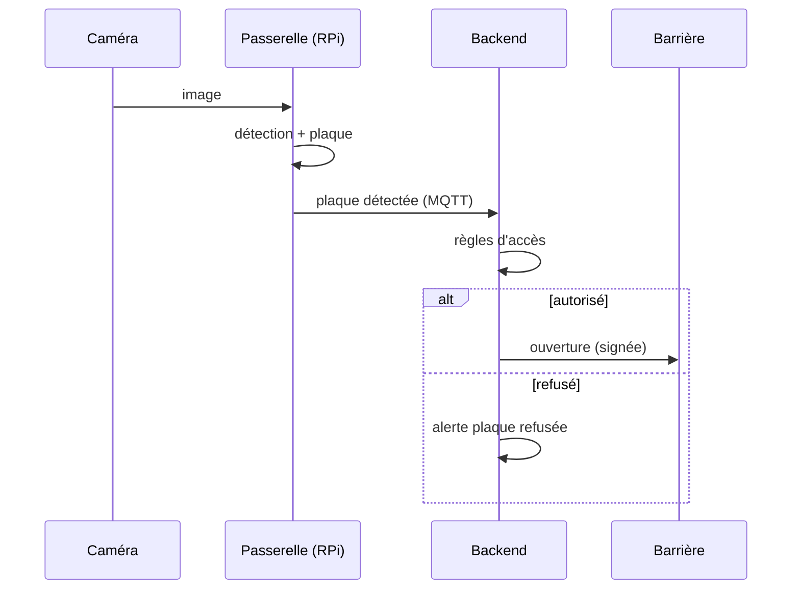

# Mawqif

Plateforme de stationnement intelligent pour le projet Cloud of Things (option AIM, SUP'COM, 2026/2027).
Encadrant : Dr. Ing. Mohamed-Bécha Kaâniche.
Équipe 1 : Amir Abbes, Anas Aouini, Mohamed Kanoun.

---

## Présentation

### Pourquoi ce projet

En Tunisie il y a de plus en plus de voitures et pas assez de places. Beaucoup de parkings gèrent l'entrée à la main et n'ont aucune donnée fiable sur leur occupation. Mawqif essaie de régler ça : lecture de plaque à l'entrée, barrière commandée automatiquement, suivi des places en temps réel, détection des voitures mal garées, et un assistant pour les automobilistes.

Une règle qu'on s'est fixée dès le départ : l'IA n'ouvre jamais la barrière. Elle explique et conseille, mais la décision et la commande passent uniquement par le backend.

Le cahier des charges est dans `docs/`.

### Ce que fait la plateforme

Côté exploitant (back-office) :
- plan d'occupation et flux vidéo annoté
- état de la barrière, compteur, ouverture manuelle
- KPI (occupation, durée moyenne, rotation, incidents, recettes) et prédiction à quelques heures
- alertes : parking complet, plaque refusée, mauvaise place, objet hors ligne

Côté automobiliste (front-office) :
- carte des parkings proches avec les places libres
- réservation et entrée sans ticket
- assistant qui répond à partir du règlement et des tarifs

Les deux interfaces sont des PWA, utilisables hors connexion.

### Déroulement pour un véhicule

1. À l'entrée, la caméra détecte la voiture et la passerelle lit la plaque.
2. Le backend décide : places restantes, réservation, liste noire.
3. Si c'est accepté, il envoie une commande signée à la barrière. Sinon, il lève une alerte.
4. À l'intérieur, la caméra suit chaque véhicule et vérifie qu'il est bien dans sa place.
5. En cas de mauvais stationnement, une preuve horodatée est enregistrée et l'agent IA aide à expliquer l'alerte.
6. À la sortie, la plaque est relue et la durée calculée.



---

## Conception technique

### Architecture

Quatre couches : objets sur le terrain, passerelle IoT (Raspberry Pi), cloud IaaS, clients PWA.

<!-- À COMPLÉTER : insérer ici votre schéma d'architecture (image dessinée par vous
dans docs/, ou le diagramme mermaid de l'équipe) -->

### Sécurité

Côté sécurité on vise du Zero Trust : DTLS 1.2 pour CoAP, TLS 1.3 pour HTTPS, mTLS avec certificats X.509, OAuth 2.0 / OIDC via Keycloak, commandes de barrière signées et journal d'audit.

### Technologies

| Partie | Choix |
|---|---|
| Passerelle | Raspberry Pi OS, CoAP, MQTT (Mosquitto), Node-RED |
| Backend | Jakarta EE 11, WildFly : deux WAR, `api-1.0.war` (API REST + WebSocket) et `iam-1.0.war` (identités, JWT) |
| Base de données | MongoDB |
| Sécurité | service IAM (OAuth 2.0, JWT), Nginx (TLS 1.3), mTLS |
| LLMOps | RAG, LangGraph, Langfuse |
| Frontend | 2 PWA |
| CI/CD | GitHub Actions |


## Prise en main

### Organisation du dépôt

```
gateway/     Node-RED, vision, scripts Raspberry Pi
backend/     Jakarta EE / WildFly : core (commun), iam (WAR identités), api (WAR métier)
frontend/    PWA automobiliste et PWA administrateur
ai-service/  agent IA, RAG, Langfuse
simulator/   faux capteurs et fausses caméras
infra/       broker, certificats de test, déploiement
docs/        cahier des charges, schémas
```

### Lancer le projet

Prérequis : Git, Docker Desktop (Compose), Python 3, Node.js 22 (seulement pour les frontends en mode développement),
`openssl` et `keytool` (livré avec le JDK) pour les certificats de test.

#### 1. Première fois seulement

```powershell
git clone https://github.com/amirabbes/COT_Mawqif.git
cd COT_Mawqif
cp .env.example .env            # puis changer les mots de passe
bash infra/setup-dev.sh         # certificats de test du broker MQTT (Git Bash ; keytool doit être dans le PATH)
```

#### 2. Démarrer le serveur

Le backend est composé de **deux services WildFly** (deux WAR) : l'API (`api-1.0.war`) et l'IAM (`iam-1.0.war`, connexion et comptes).
Le service `api-builder` du Compose les compile dans un conteneur Maven et les dépose dans `backend/deployments` ; WildFly les déploie tout seul.
Il y a deux façons de lancer le projet (un seul à la fois) :

**Mode A — développement** (frontends lancés par Vite, tout accessible par l'adresse IP du serveur) :

```powershell
docker compose up -d
cd frontend\driver-app; npm install; npm run dev      # PWA automobiliste  http://localhost:5173
cd frontend\admin-app;  npm install; npm run dev      # PWA exploitant     http://localhost:5174
python simulator\simulator.py                          # faux capteurs (facultatif)
```

API : `http://localhost:8081/api/v1` — IAM : `http://localhost:8081/iam/v1` — WebSocket : `ws://localhost:8081/api/ws/{driver|admin}`.

**Mode B — « WildFly sert tout » (consigne de l'enseignant)** : WildFly sert lui-même les deux PWA, l'API et l'IAM, chacun sur son nom de
domaine (hôtes virtuels Undertow), grâce aux scripts `infra/wildfly/cli/*.cli` (`default-host.cli`, `add-host.cli`, `add-api.cli`, fournis
par l'enseignant et non modifiés) et aux fichiers `infra/wildfly/*-dev.properties` / `*-prod.properties`.

```powershell
docker compose -f docker-compose.yml -f docker-compose.hosts.yml up -d
```

Le Compose compile les frontends (`npm run build`), applique les scripts `.cli` à WildFly, puis le démarre. Les sites sont :

| Nom | Contenu |
|---|---|
| `http://www.mawqif.local:8081` | PWA automobiliste |
| `http://admin.mawqif.local:8081` | PWA exploitant |
| `http://api.mawqif.local:8081/v1` | API REST (WebSocket : `/ws/...`) |
| `http://iam.mawqif.local:8081/v1` | IAM (`/auth/token`, `/auth/register`, `/auth/me`, `/identities`) |

Ces noms doivent être associés à l'adresse du serveur dans le fichier `hosts` de **chaque ordinateur** qui ouvre les sites
(`C:\Windows\System32\drivers\etc\hosts`, éditeur lancé en administrateur ; `/etc/hosts` sous macOS et Linux) :

```
127.0.0.1   www.mawqif.local admin.mawqif.local api.mawqif.local iam.mawqif.local
```

(`127.0.0.1` sur le serveur lui-même, l'adresse du serveur sur les autres ordinateurs : voir ci-dessous.)

Pour passer d'un mode à l'autre : `docker compose -f docker-compose.yml -f docker-compose.hosts.yml down` puis relancer l'autre mode
(ou, du mode B vers le mode A : `docker compose up -d --remove-orphans`). Les données MongoDB sont conservées.

**Comptes de test** (créés au démarrage par le service IAM ; à changer hors développement) :

| Compte | Mot de passe | Rôle |
|---|---|---|
| `admin` | `admin12345` | ADMIN : tout, y compris la gestion des comptes |
| `operator` | `operator12345` | OPERATOR : alertes, objets, barrière, toutes les réservations |
| `driver` | `driver12345` | DRIVER : consulter les parkings, ses propres réservations |

#### 3. Héberger sur le réseau local et s'y connecter depuis d'autres appareils

Sur le **serveur** (l'ordinateur qui exécute Docker) :

1. Trouver son adresse IP : `ipconfig`, ligne « Adresse IPv4 » de la carte Wi-Fi ou Ethernet (par exemple `192.168.1.14`).
2. Autoriser les connexions entrantes dans le pare-feu Windows (PowerShell **en administrateur**, une seule fois) :
   ```powershell
   New-NetFirewallRule -DisplayName "Mawqif" -Direction Inbound -Protocol TCP -LocalPort 8081,5173,5174,1883 -Action Allow -Profile Any
   ```
   (8081 : backend et mode B — 5173 et 5174 : frontends du mode A — 1883 : MQTT pour une Raspberry Pi.)
3. Démarrer le serveur (mode A ou mode B, voir plus haut).

Sur un **autre appareil du même réseau Wi-Fi** (mobile désactivé, même réseau que le serveur) :

- **Mode A** (le plus simple, marche aussi sur téléphone) : ouvrir `http://192.168.1.14:5173` (automobiliste) ou `http://192.168.1.14:5174`
  (exploitant). Test rapide du backend : `http://192.168.1.14:8081/api/v1/health` doit afficher `{"status":"UP"}`.
- **Mode B** (ordinateurs) : ajouter une fois dans le fichier `hosts` de l'appareil la ligne
  `192.168.1.14   www.mawqif.local admin.mawqif.local api.mawqif.local iam.mawqif.local`
  puis ouvrir `http://www.mawqif.local:8081` ou `http://admin.mawqif.local:8081`. Un téléphone ne permet pas de modifier le fichier `hosts` :
  utiliser le mode A.

Si un appareil n'arrive pas à se connecter : vérifier qu'il est sur le même réseau (son adresse commence par les mêmes chiffres, par exemple
`192.168.1.`), écrire `http://` (et non `https://`), et désactiver l'isolation des clients (« AP isolation ») dans le routeur. L'adresse du serveur
peut changer d'un réseau à l'autre : refaire `ipconfig` et utiliser la nouvelle (rien d'autre à reconfigurer ; en mode B, mettre à jour le fichier `hosts`).
Le serveur n'a pas de HTTPS : ne l'exposer que sur un réseau de confiance et changer les mots de passe de `.env`.

#### 4. Vrai domaine (production)

Renseigner `infra/wildfly/*-prod.properties` (remplacer `your-domain.tld`), lancer le mode B avec `WF_ENV=prod`, `CORS_ENABLED=false`
(WildFly ajoute alors lui-même les en-têtes CORS pour les origines `https://`), `IAM_JWT_SECRET` (même clé pour `iam` et `api`),
`HOSTS_API_URL` et `HOSTS_IAM_URL`, et placer HTTPS devant WildFly : les scripts de l'enseignant redirigent le port 80 vers HTTPS.

---

## Licence

Projet académique COT, SUP'COM 2026/2027.
