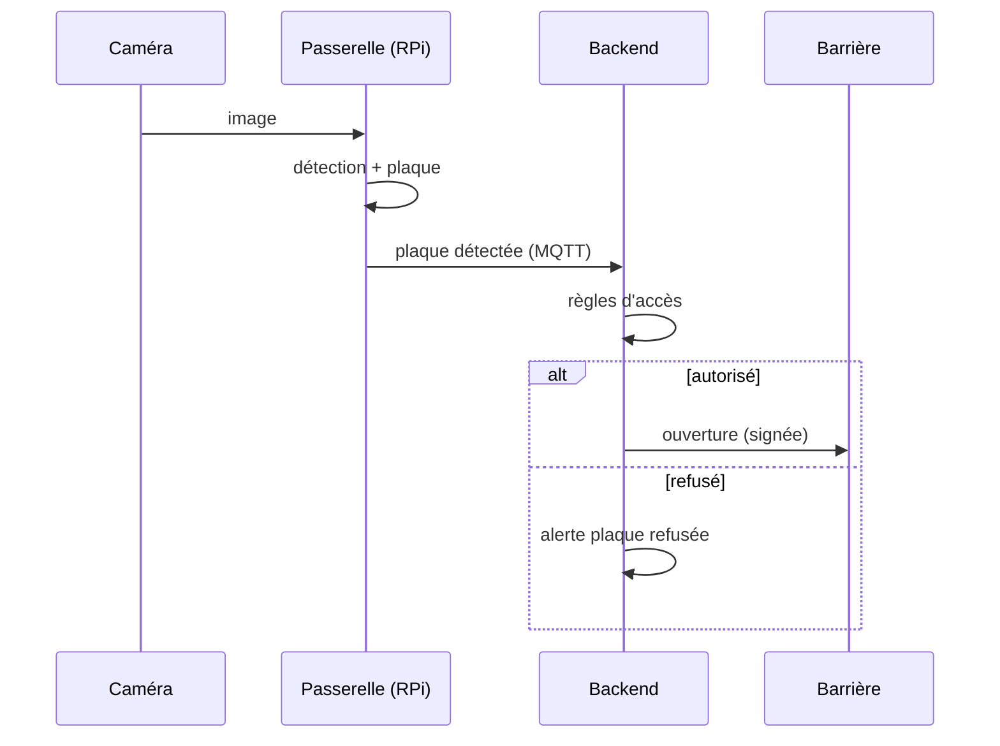

# Mawqif

Plateforme de stationnement intelligent pour le projet Cloud of Things (option AIM, SUP'COM, 2026/2027).
Encadrant : Dr. Ing. Mohamed-Bécha Kaâniche.
Équipe 1 : Amir Abbes, Anas Aouini, Mohamed Kanoun.

---

## Présentation

### Pourquoi ce projet

En Tunisie il y a de plus en plus de voitures et pas assez de places. Beaucoup de parkings gèrent l'entrée à la main et n'ont aucune donnée fiable sur leur occupation. Mawqif essaie de régler ça : lecture de plaque à l'entrée, barrière commandée automatiquement, suivi des places en temps réel, détection des voitures mal garées, et un assistant pour les automobilistes.

Une règle qu'on s'est fixée dès le départ : l'IA n'ouvre jamais la barrière. Elle explique et conseille, mais la décision et la commande passent uniquement par le backend.

Le cahier des charges est dans `docs/`.

### Ce que fait la plateforme

Côté exploitant (back-office) :
- plan d'occupation et flux vidéo annoté
- état de la barrière, compteur, ouverture manuelle
- KPI (occupation, durée moyenne, rotation, incidents, recettes) et prédiction à quelques heures
- alertes : parking complet, plaque refusée, mauvaise place, objet hors ligne

Côté automobiliste (front-office) :
- carte des parkings proches avec les places libres
- réservation et entrée sans ticket
- assistant qui répond à partir du règlement et des tarifs

Les deux interfaces sont des PWA, utilisables hors connexion.

### Déroulement pour un véhicule

1. À l'entrée, la caméra détecte la voiture et la passerelle lit la plaque.
2. Le backend décide : places restantes, réservation, liste noire.
3. Si c'est accepté, il envoie une commande signée à la barrière. Sinon, il lève une alerte.
4. À l'intérieur, la caméra suit chaque véhicule et vérifie qu'il est bien dans sa place.
5. En cas de mauvais stationnement, une preuve horodatée est enregistrée et l'agent IA aide à expliquer l'alerte.
6. À la sortie, la plaque est relue et la durée calculée.

---

## Conception technique

### Architecture

Quatre couches : objets sur le terrain, passerelle IoT (Raspberry Pi), cloud IaaS, clients PWA.

<!-- À COMPLÉTER : insérer ici votre schéma d'architecture (image dessinée par vous
dans docs/, ou le diagramme mermaid de l'équipe) -->

### Sécurité

Côté sécurité on vise du Zero Trust : DTLS 1.2 pour CoAP, TLS 1.3 pour HTTPS, mTLS avec certificats X.509, OAuth 2.0 / OIDC via Keycloak, commandes de barrière signées et journal d'audit.

### Technologies

| Partie | Choix |
|---|---|
| Passerelle | Raspberry Pi OS, CoAP, MQTT (Mosquitto), Node-RED |
| Backend | Jakarta EE 11, WildFly, API REST |
| Base de données | MongoDB |
| Sécurité | Keycloak, Nginx (TLS 1.3), mTLS |
| LLMOps | RAG, LangGraph, Langfuse |
| Frontend | 2 PWA |
| CI/CD | GitHub Actions |

## Licence

Projet académique COT, SUP'COM 2026/2027.
