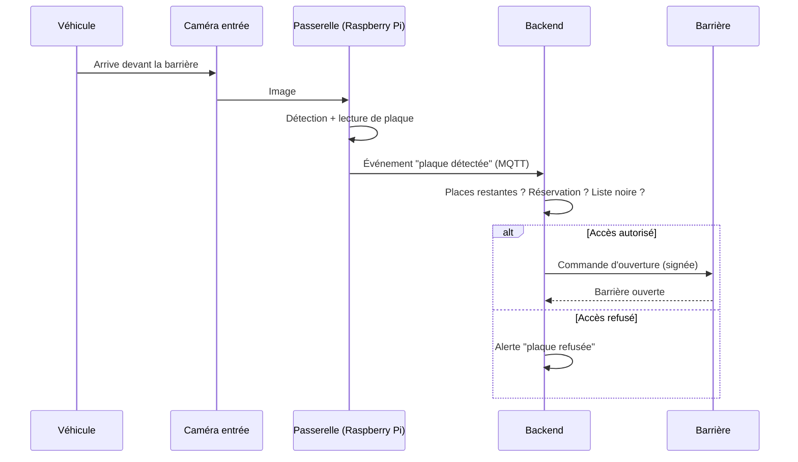
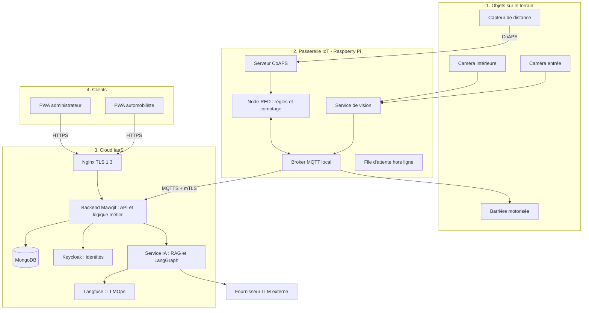

# COT_Mawqif_ÉQUIPE_1_2026_2027
**Plateforme de stationnement intelligent, sécurisé et conversationnel.**

Projet Cloud Of Things (COT) · Option AIM · SUP'COM · Année universitaire 2026/2027
Encadrant : Dr. Ing. Mohamed-Bécha Kaâniche
**Équipe 1** : Amir Abbes · Anas Aouini · Mohamed Kanoun

---

## Sommaire

1. [C'est quoi Mawqif ?](#1-cest-quoi-mawqif-)
2. [Fonctionnalités](#2-fonctionnalités)
3. [Parcours d'un véhicule](#3-parcours-dun-véhicule)
4. [Architecture](#4-architecture)
5. [Technologies](#5-technologies)
6. [Messages MQTT (proposition)](#6-messages-mqtt-proposition)
7. [Structure du dépôt](#7-structure-du-dépôt)
8. [Lancer le projet](#8-lancer-le-projet)
9. [Façon de travailler](#9-façon-de-travailler)
10. [Répartition des rôles](#10-répartition-des-rôles)
11. [Planning et avancement](#11-planning-et-avancement)
12. [Risques et plans B](#12-risques-et-plans-b)

---

## 1. C'est quoi Mawqif ?

En Tunisie, le nombre de voitures augmente, mais les places de parking ne suivent pas. Les exploitants de parkings ont peu de données fiables et gèrent souvent l'accès à la main.

**Mawqif** aide un exploitant de parking à :

- **automatiser l'entrée** des voitures (lecture de plaque, barrière motorisée) ;
- **voir en temps réel** quelles places sont libres ;
- **détecter** les voitures mal garées et garder une preuve ;
- **aider les automobilistes** à trouver et réserver une place, avec un assistant IA.

> 🔒 **Règle importante** : l'IA explique et assiste, mais elle ne prend **jamais** de décision critique. C'est la plateforme qui décide et qui commande la barrière.

Le cahier des charges complet est dans le dossier [`docs/`](docs/).

## 2. Fonctionnalités

**Pour l'exploitant (back-office)**

- Plan d'occupation et flux vidéo annoté en temps réel
- État de la barrière, compteur de véhicules, commande manuelle de la barrière
- KPI : taux d'occupation, durée moyenne, rotation, incidents, recettes
- Alertes : parking complet, plaque refusée, mauvaise place, objet hors ligne, accès non autorisé
- Prédiction du taux d'occupation à quelques heures

**Pour l'automobiliste (front-office)**

- Carte des parkings proches avec les places libres
- Réservation d'une place, entrée sans ticket
- Assistant conversationnel : il répond en citant le règlement et les tarifs, et explique les alertes

**Pour tout le monde**

- Deux PWA installables, consultables hors connexion
- Sécurité Zero Trust de bout en bout

## 3. Parcours d'un véhicule

| # | Étape | Ce qui se passe |
|---|---|---|
| 1 | **Entrée** | Détection du véhicule, comptage, lecture de plaque, décision d'accès |
| 2 | **Suivi** | La caméra dessine un rectangle par véhicule et repère les places libres |
| 3 | **Contrôle** | Le véhicule est-il sur la bonne place ? Recouvrement et angle corrects ? |
| 4 | **Incident et IA** | Preuve horodatée, alerte, l'agent IA explique et notifie |
| 5 | **Sortie** | Lecture de plaque, calcul de la durée |

Décision d'accès à l'entrée (sans intervention humaine) :



## 4. Architecture

Quatre couches : (1) objets connectés, (2) passerelle IoT, (3) cloud IaaS, (4) clients.



**Sécurité (Zero Trust)** : DTLS 1.2 pour CoAP, TLS 1.3 pour HTTPS, mTLS avec certificats X.509 entre objets, passerelle et services, OAuth 2.0 et OpenID Connect pour les utilisateurs, commandes signées et journal d'audit.

## 5. Technologies

| Couche | Outils |
|---|---|
| Passerelle et périphérie | Raspberry Pi OS, CoAP, MQTT, Node-RED |
| Vision par ordinateur | *(à choisir)* |
| Middleware / backend | Jakarta EE 11, WildFly, API REST |
| Base de données | MongoDB |
| Sécurité | Zero Trust, TLS 1.3, DTLS 1.2, mTLS (X.509), OAuth 2.0 / OIDC, Keycloak |
| IA | Agent IA avec RAG, LangGraph |
| LLMOps | Langfuse (prompts versionnés, évaluations, suivi des coûts) |
| Frontend | 2 PWA |
| CI/CD | GitHub Actions |

## 6. Messages MQTT (proposition)

À valider ensemble à la **semaine 2**. L'idée : tout le monde utilise les mêmes noms et le même format JSON.

| Topic | Qui publie | Exemple de contenu |
|---|---|---|
| `mawqif/{parking}/entree/vehicule` | Passerelle | `{"plaque": "123 TUN 4567", "ts": "2026-11-05T09:30:00Z"}` |
| `mawqif/{parking}/places/{id}` | Passerelle | `{"etat": "occupee", "ts": "..."}` |
| `mawqif/{parking}/barriere/commande` | Backend | `{"action": "ouvrir", "signature": "..."}` |
| `mawqif/{parking}/incidents` | Passerelle / Backend | `{"type": "mauvaise_place", "place": 7, "preuve": "..."}` |

## 7. Structure du dépôt

```
mawqif/
├── gateway/       # Passerelle : Node-RED, vision, scripts Raspberry Pi
├── backend/       # Backend Jakarta EE / WildFly
├── frontend/      # PWA automobiliste et PWA administrateur
├── ai-service/    # Agent IA, RAG, Langfuse
├── simulator/     # Faux capteurs et fausses caméras (tests sans matériel)
├── infra/         # Config du broker, certificats de test, scripts de déploiement
├── docs/          # Cahier des charges, schémas
├── docker-compose.yml
└── README.md
```

## 8. Lancer le projet

### À installer

- Git
- Docker et Docker Compose
- Python 3 (pour le simulateur)

### Démarrage rapide

```bash
# 1. Récupérer le code
git clone <URL_DU_DEPOT>
cd mawqif

# 2. Lancer MongoDB, le broker MQTT et Node-RED
docker compose up -d

# 3. Envoyer de faux événements
python simulator/simulator.py
```

> ⚠️ Cette partie sera complétée au fur et à mesure (voir semaine 1).

## 9. Façon de travailler

- `main` est la branche **stable** : on ne pousse jamais directement dessus.
- Chacun travaille sur sa branche : `feature/nom-court` (ex. `feature/simulateur-mqtt`).
- On propose les changements avec une **Pull Request**, relue par au moins une autre personne.
- Messages de commit courts et clairs :
  - `feat: ajout du simulateur MQTT`
  - `fix: correction du topic de la barrière`
  - `docs: mise à jour du README`
- **Jamais** de mot de passe, de clé privée ou de jeton dans Git (utiliser un fichier `.env` ignoré par Git).
- À la fin de chaque séance : on pousse, on coche le planning ci-dessous, on note ce qui reste.

## 10. Répartition des rôles

| Personne | Responsabilité principale | Soutien sur |
|---|---|---|
| *(à remplir)* | Passerelle : MQTT/CoAP, Node-RED, vision | Backend |
| *(à remplir)* | Backend : Jakarta EE, MongoDB, sécurité | Passerelle |
| *(à remplir)* | PWA, agent IA, LLMOps | Backend |

Dans le planning, les étiquettes **[Passerelle]**, **[Backend]** et **[Front/IA]** indiquent qui s'occupe de quoi. **[Tous]** veut dire qu'on le fait ensemble.

## 11. Planning et avancement

Durée : **8 semaines**, avec **1 jour de travail par semaine**. Cocher les cases au fur et à mesure.

### Semaine 1 · Fondations

- [ ] [Tous] Créer le dépôt GitHub et la structure des dossiers
- [ ] [Tous] Ajouter le README, le `.gitignore` et les règles de branches
- [ ] [Backend] Écrire le `docker-compose.yml` : MongoDB, broker MQTT (Mosquitto), Node-RED
- [ ] [Passerelle] Écrire le simulateur : il envoie de faux événements MQTT (entrée d'une voiture, place occupée)
- [ ] [Front/IA] Préparer les squelettes des deux PWA (projet vide qui démarre)
- [ ] [Tous] Faire le premier push et vérifier que `docker compose up` marche chez les trois

**Livrable** : un dépôt propre, que chacun peut cloner et lancer.

### Semaine 2 · Squelette de bout en bout

- [ ] [Tous] Valider les topics MQTT et le format des messages (section 6)
- [ ] [Passerelle] Créer un flux Node-RED qui reçoit les événements et compte les entrées/sorties
- [ ] [Backend] Créer le backend Jakarta EE minimal : il reçoit les messages MQTT et les enregistre dans MongoDB
- [ ] [Backend] Ajouter un premier endpoint REST : nombre de places libres
- [ ] [Front/IA] Faire une page simple qui affiche les places libres

**Livrable** : simulateur → MQTT → backend → MongoDB → page web.

### Semaine 3 · Vision et occupation des places

- [ ] [Passerelle] Installer Raspberry Pi OS, brancher la caméra, tester le flux vidéo
- [ ] [Passerelle] Détecter les véhicules (un rectangle par véhicule)
- [ ] [Passerelle] Définir la zone de chaque place et décider : libre ou occupée
- [ ] [Passerelle] Envoyer l'état des places par MQTT
- [ ] [Backend] Mettre à jour l'occupation en base et la diffuser en temps réel
- [ ] [Front/IA] Afficher le plan d'occupation dans la PWA

**Livrable** : l'occupation des places détectée sur une vidéo de test et visible dans la PWA.

### Semaine 4 · Accès automatique et réservation

- [ ] [Passerelle] Lire la plaque d'immatriculation à l'entrée
- [ ] [Passerelle] Brancher le capteur de distance et la barrière (agent-capteur, agent-barrière)
- [ ] [Backend] Écrire les règles de décision : places restantes, réservation, liste noire
- [ ] [Backend] Créer l'API de réservation et la gestion des sessions
- [ ] [Front/IA] Écrire l'écran de réservation et la carte des parkings proches

**Livrable** : une voiture arrive, la plaque est lue, la décision est prise, la barrière s'ouvre ou reste fermée.

### Semaine 5 · Contrôle du stationnement et incidents

- [ ] [Passerelle] Associer chaque plaque à la place occupée
- [ ] [Passerelle] Détecter un mauvais stationnement (recouvrement et angle des places)
- [ ] [Backend] Créer une preuve horodatée (image + événement) et la stocker
- [ ] [Backend] Générer les alertes : parking complet, plaque refusée, mauvaise place, objet hors ligne
- [ ] [Passerelle] Mettre en place la file d'attente hors ligne (les événements sont gardés si la connexion tombe)
- [ ] [Front/IA] Afficher les alertes et les preuves dans le back-office

**Livrable** : un mauvais stationnement est détecté, prouvé et signalé à l'exploitant.

### Semaine 6 · Sécurité et agent IA

- [ ] [Backend] Installer Keycloak : OAuth 2.0 et OpenID Connect pour les utilisateurs
- [ ] [Backend] Mettre en place TLS 1.3 avec Nginx et un journal d'audit
- [ ] [Passerelle] Mettre en place mTLS (certificats X.509) et DTLS 1.2 pour CoAP, puis signer les commandes de la barrière
- [ ] [Front/IA] Créer l'agent IA : explication des incidents, réponses sur les tarifs et le règlement (RAG)
- [ ] [Front/IA] Brancher Langfuse : prompts versionnés, suivi des réponses et des coûts
- [ ] [Front/IA] Ajouter une protection contre l'injection de prompt (l'IA ne commande jamais la barrière)

**Livrable** : accès protégé de bout en bout et premier assistant IA qui répond.

### Semaine 7 · PWA complètes, KPI et intégration sur le matériel

- [ ] [Backend] Calculer les KPI : taux d'occupation, durée moyenne, rotation, incidents, recettes
- [ ] [Backend] Prédire le taux d'occupation à quelques heures
- [ ] [Front/IA] Finaliser les deux PWA : installation, mode hors connexion, tableau de bord KPI
- [ ] [Front/IA] Ajouter les notifications aux automobilistes
- [ ] [Tous] Tester le tout sur le vrai matériel (caméras, capteur, barrière)
- [ ] [Tous] Corriger les problèmes trouvés

**Livrable** : la solution complète tourne sur le vrai matériel.

### Semaine 8 · Finalisation et démo

- [ ] [Tous] Gel des fonctionnalités : on ne corrige que les bugs
- [ ] [Tous] Tests finaux et mesure des performances
- [ ] [Tous] Écrire le rapport et mettre à jour la documentation
- [ ] [Tous] Préparer un scénario de démo, le répéter, prévoir un plan B (vidéo de secours)
- [ ] [Tous] Mettre en place le déploiement automatique avec GitHub Actions (si pas encore fait)

**Livrable** : démo finale et rapport.

## 12. Risques et plans B

| Risque | Plan B |
|---|---|
| Le matériel n'est pas disponible à temps | On continue avec le simulateur et des vidéos de test |
| La lecture de plaque est mauvaise (lumière, obstacles) | Tester sur des images variées, ajuster la caméra, garder une saisie manuelle de secours |
| Le fournisseur de LLM est indisponible ou trop cher | Mode dégradé : réponses prédéfinies, limite de requêtes |
| Un membre de l'équipe est absent | Chacun a un rôle de soutien et le code passe par des Pull Requests lues par un autre |
| La sécurité est laissée à la fin | Tester TLS simple dès la semaine 2, renforcer à la semaine 6 |

## Licence

Projet académique · SUP'COM 2026/2027.
