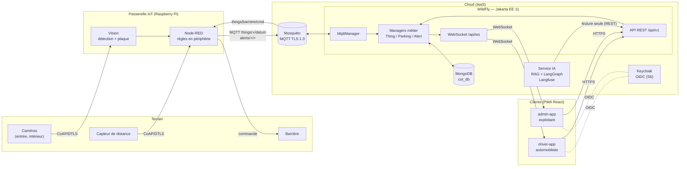
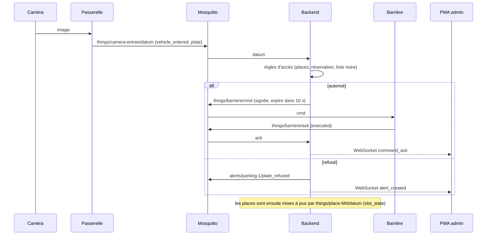
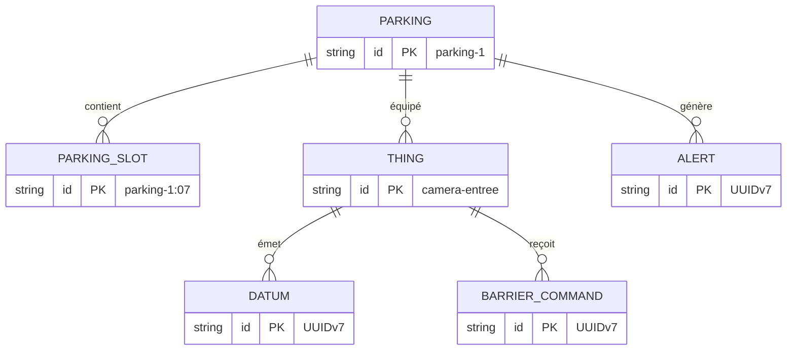

# Architecture — Mawqif

Cadre d'architecture de la plateforme (version semaine 3, en revue). Les interfaces exactes sont dans [`contracts/`](contracts/).

## 1. Vue d'ensemble

Quatre couches : **objets** sur le terrain, **passerelle IoT** (Raspberry Pi), **cloud IaaS** (backend + données), **clients** (2 PWA).



## 2. Responsabilités

| Composant | Rôle | Ne fait **pas** |
|---|---|---|
| Objets (caméras, capteurs, barrière) | observer, exécuter | décider |
| Passerelle | lire la plaque, appliquer des règles locales, publier en MQTT | ouvrir la barrière sans ordre du backend |
| Mosquitto | transporter les messages (TLS 1.3 + mot de passe) | logique métier |
| Backend (WildFly) | **décider** (accès, alertes), persister, exposer REST/WebSocket, signer les commandes | — |
| MongoDB | état courant + historique | — |
| Service IA | expliquer et conseiller (RAG sur règlement et tarifs) | écrire, commander |
| PWA | afficher, réserver, ouverture manuelle (opérateur) | accéder à MQTT |

**Règle d'or : l'IA n'ouvre jamais la barrière.** Elle n'a que des routes REST en lecture ; la commande ne part que du backend, signée.

## 3. Modules du backend

Même découpage Maven que `cot.zip` du prof (modules `core` + `api`), le module `iam` étant remplacé par Keycloak.

```
backend/
  pom.xml                      parent (modules : core, api)
  core/                        du prof : NosqlEntity, UUIDv7, ETagSupport, managers abstraits
  api/                         WAR déployé par WildFly (contexte /api)
    entities/                  modèles IoT (Thing, Parking, ParkingSlot, Alert, BarrierCommand, Datum)
    controllers/repositories/  Jakarta Data (MongoDB via JNoSQL)
    controllers/managers/      MqttManager, ThingManager, ParkingManager, AlertManager, WebSocketManager
    boundaries/                ressources REST + DTO (= contrat OpenAPI)
    mqtt/                      Topics (= contrat MQTT)
```

Flux interne : `MqttManager.messageArrived` → `ThingManager` / `AlertManager` (persistance) → `WebSocketManager.broadcast`.
Flux REST : `*Resource` → `*Manager` → repository.

## 4. Flux principal : un véhicule entre



*Semaine 3 : la réception, la persistance et la diffusion sont en place ; les règles d'accès (étape « règles d'accès ») arrivent la semaine suivante.*

## 5. Modèle de données (MongoDB, base `cot_db`)



Tous héritent de `NosqlEntity` (`_id` texte + `version` pour l'ETag). Les identifiants métier sont ceux du contrat MQTT ; les journaux (`Datum`, `Alert`, `BarrierCommand`) utilisent `UUIDv7`.

## 6. Déploiement local

`docker compose up -d` démarre MongoDB (27017), Mosquitto (1882 TLS / 1883) et WildFly (8081 → application, 9990 → console) ; `--profile gateway` ajoute Node-RED (1880). WildFly déploie le WAR présent dans `backend/deployments/`. Pour construire et déployer l'API depuis la racine du dépôt :

```powershell
docker run --rm -v "${PWD}/backend:/app" -w /app maven:3.9-eclipse-temurin-25 mvn -q clean package
Copy-Item .\backend\api\target\api.war .\backend\deployments\api.war -Force
```

Le backend utilise le pilote MongoDB synchrone déjà empaqueté dans le WAR, avec l'URI `JNOSQL_MONGODB_URL` et la base `cot_db`. Maven ne tourne qu'au moment de la compilation ; il n'est pas un service Compose.

| Service | URL locale |
|---|---|
| API REST | `http://localhost:8081/api/v1` |
| WebSocket | `ws://localhost:8081/api/ws/{driver\|admin}` |
| PWA automobiliste | `http://localhost:5173` |
| PWA exploitant | `http://localhost:5174` |

## 7. Sécurité (cible)

DTLS 1.2 (CoAP), TLS 1.3 (MQTT, HTTPS), mTLS X.509 pour les objets, OAuth 2.0 / OIDC (Keycloak) pour les PWA, commandes de barrière signées avec expiration, journal d'audit. Déjà en place en local : TLS 1.3 + identifiant/mot de passe sur Mosquitto, signature HMAC des commandes.

## 8. Décisions

| # | Décision | Raison |
|---|---|---|
| D1 | Le backend est le seul décideur | sécurité, traçabilité |
| D2 | Contrats d'abord (OpenAPI + JSON Schema), code ensuite | équipe de 3 qui travaille en parallèle |
| D3 | Mêmes topics que le backend du prof | réutiliser `MqttManager` et le simulateur |
| D4 | MongoDB + Jakarta NoSQL | imposé par `cot.zip` |
| D5 | REST pour l'état, WebSocket pour les changements | PWA simples, pas de MQTT côté navigateur |
| D6 | Commandes signées HMAC + expiration | protection contre rejeu et usurpation |
