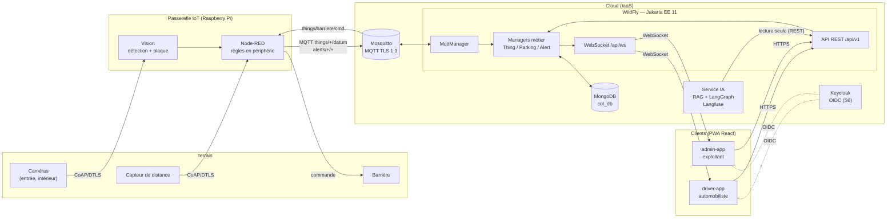
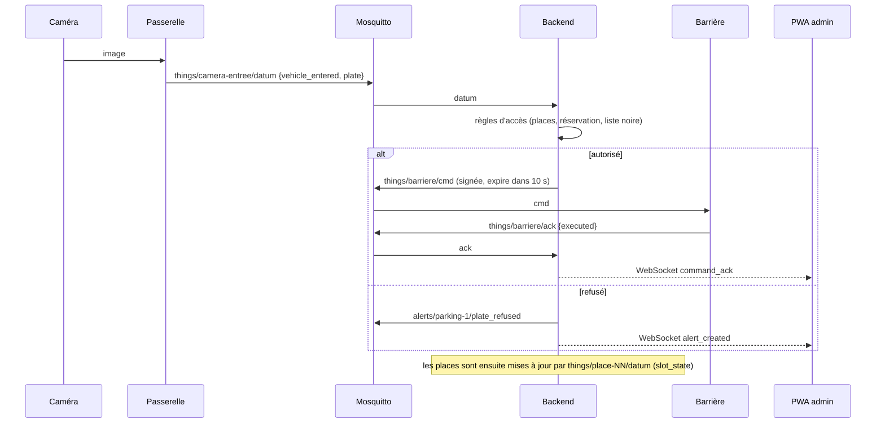
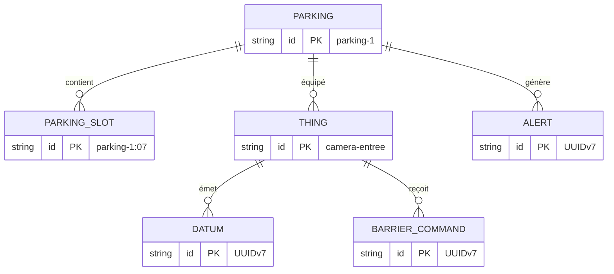

# Architecture — Mawqif

Cadre d'architecture de la plateforme (version semaine 3, en revue). Les interfaces exactes sont dans [`contracts/`](contracts/).

## 1. Vue d'ensemble

Quatre couches : **objets** sur le terrain, **passerelle IoT** (Raspberry Pi), **cloud IaaS** (backend + données), **clients** (2 PWA).



## 2. Responsabilités

| Composant | Rôle | Ne fait **pas** |
|---|---|---|
| Objets (caméras, capteurs, barrière) | observer, exécuter | décider |
| Passerelle | lire la plaque, appliquer des règles locales, publier en MQTT | ouvrir la barrière sans ordre du backend |
| Mosquitto | transporter les messages (TLS 1.3 + mot de passe) | logique métier |
| Backend (WildFly) | **décider** (accès, alertes), persister, exposer REST/WebSocket, signer les commandes | — |
| MongoDB | état courant + historique | — |
| Service IA | expliquer et conseiller (RAG sur règlement et tarifs) | écrire, commander |
| PWA | afficher, réserver, ouverture manuelle (opérateur) | accéder à MQTT |

**Règle d'or : l'IA n'ouvre jamais la barrière.** Elle n'a que des routes REST en lecture ; la commande ne part que du backend, signée.

## 3. Modules du backend

Même découpage Maven que `cot.zip` du prof : un module commun `core` et deux WAR, `iam` (identités) et `api` (métier).

```
backend/
  pom.xml                      parent (modules : core, iam, api)
  core/                        du prof : NosqlEntity, UUIDv7, ETagSupport, managers abstraits
                               + security/ : JwtService, Role, Scopes, PasswordHasher, @Secured, AuthFilter, TokenVerifier
  iam/                         WAR iam-1.0.war (contexte /iam) : Identity, Tenant, Grant, IamManager, /auth/*, /identities
                               base MongoDB propre « iam_db » ; émet les JWT (HS256)
  api/                         WAR api-1.0.war (contexte /api) : vérifie les JWT (clé partagée IAM_JWT_SECRET)
    entities/                  modèles IoT (Thing, Parking, ParkingSlot, Alert, BarrierCommand, Datum)
    controllers/repositories/  Jakarta Data (MongoDB via JNoSQL)
    controllers/managers/      MqttManager, ThingManager, ParkingManager, AlertManager, WebSocketManager
    boundaries/                ressources REST + DTO (= contrat OpenAPI)
    mqtt/                      Topics (= contrat MQTT)
```

Flux interne : `MqttManager.messageArrived` → `ThingManager` / `AlertManager` (persistance) → `WebSocketManager.broadcast`.
Flux REST : `*Resource` → `*Manager` → repository.

## 4. Flux principal : un véhicule entre



*Semaine 3 : la réception, la persistance et la diffusion sont en place ; les règles d'accès (étape « règles d'accès ») arrivent la semaine suivante.*

## 5. Modèle de données (MongoDB, base `cot_db`)



Tous héritent de `NosqlEntity` (`_id` texte + `version` pour l'ETag). Les identifiants métier sont ceux du contrat MQTT ; les journaux (`Datum`, `Alert`, `BarrierCommand`) utilisent `UUIDv7`.

## 6. Déploiement local

`docker compose up -d` démarre MongoDB (27017), Mosquitto (1882 TLS / 1883) et WildFly (8081 → application, 9990 → console) ; `--profile gateway` ajoute Node-RED (1880). Le service one-shot `api-builder` compile l'API dans un conteneur Maven (sur une copie des sources) et dépose `api-1.0.war` dans `backend/deployments/` ; WildFly attend qu'il ait réussi, puis déploie le WAR.

Le backend utilise le pilote MongoDB synchrone déjà empaqueté dans le WAR, avec l'URI `JNOSQL_MONGODB_URL` et la base `cot_db`.

### Mode « WildFly sert tout » (consigne de l'enseignant)

`docker compose -f docker-compose.yml -f docker-compose.hosts.yml up -d` configure WildFly avec les scripts `infra/wildfly/cli/*.cli` fournis par l'enseignant (Undertow, un hôte virtuel par domaine) :

| Hôte virtuel | Script | Contenu | URL (dev) |
|---|---|---|---|
| `default-host` | `default-host.cli` | PWA automobiliste (fichiers de `infra/wildfly/www/root`) | `http://www.mawqif.local:8081` |
| `admin-host` | `add-host.cli` | PWA exploitant (`infra/wildfly/www/admin`) | `http://admin.mawqif.local:8081` |
| `api-host` | `add-api.cli` | `api-1.0.war` servi à la racine | `http://api.mawqif.local:8081/v1` |
| `iam-host` | `add-api.cli` | `iam-1.0.war` servi à la racine | `http://iam.mawqif.local:8081/v1` |

- `frontend-builder` exécute `npm run build` pour les deux PWA, avec `VITE_API_URL` = hôte de l'API et `VITE_API_PREFIX` vide (l'API n'est plus sous `/api`).
- `wildfly-config` applique les scripts à `standalone.xml` en mode embarqué (`infra/wildfly/apply-config.sh`, idempotent, restaure le fichier en cas d'échec) avant le démarrage de WildFly. Les `.properties` existent par environnement : `*-dev.properties` (`mawqif.local`) et `*-prod.properties` (`your-domain.tld`, à adapter).
- `WEB-INF/jboss-web.xml` de l'API garde le contexte `/api` en développement et, avec `API_VIRTUAL_HOST=api-host`, place l'application sur `api-host`.
- CORS : les scripts ajoutent les en-têtes CORS pour les origines `https://*.domaine` seulement. En HTTP (dev) notre `CorsFilter` reste actif ; en HTTPS (prod) le désactiver (`CORS_ENABLED=false`) pour ne pas doubler les en-têtes.
- Les scripts redirigent le port 80 vers HTTPS (HSTS) : la terminaison TLS (WildFly ou proxy) reste à mettre en place pour la prod.
- IAM : WAR séparé `iam-1.0.war` sur `iam-host` (`add-api.cli` avec `api.name=iam`, `infra/wildfly/iam-*.properties`), comme le module `iam` de `cot.zip`. Le jeton émis par `iam` est vérifié par `api` avec la clé HMAC partagée `IAM_JWT_SECRET` (évolution possible : RS256 + clé publique).

| Service | URL locale |
|---|---|
| API REST | `http://localhost:8081/api/v1` |
| WebSocket | `ws://localhost:8081/api/ws/{driver\|admin}` |
| PWA automobiliste | `http://localhost:5173` |
| PWA exploitant | `http://localhost:5174` |

## 7. Sécurité (cible)

DTLS 1.2 (CoAP), TLS 1.3 (MQTT, HTTPS), mTLS X.509 pour les objets, OAuth 2.0 (service `iam`, jetons JWT) pour les PWA, commandes de barrière signées avec expiration, journal d'audit. Déjà en place en local : TLS 1.3 + identifiant/mot de passe sur Mosquitto, signature HMAC des commandes.

## 8. Décisions

| # | Décision | Raison |
|---|---|---|
| D1 | Le backend est le seul décideur | sécurité, traçabilité |
| D2 | Contrats d'abord (OpenAPI + JSON Schema), code ensuite | équipe de 3 qui travaille en parallèle |
| D3 | Mêmes topics que le backend du prof | réutiliser `MqttManager` et le simulateur |
| D4 | MongoDB + Jakarta NoSQL | imposé par `cot.zip` |
| D5 | REST pour l'état, WebSocket pour les changements | PWA simples, pas de MQTT côté navigateur |
| D6 | Commandes signées HMAC + expiration | protection contre rejeu et usurpation |
